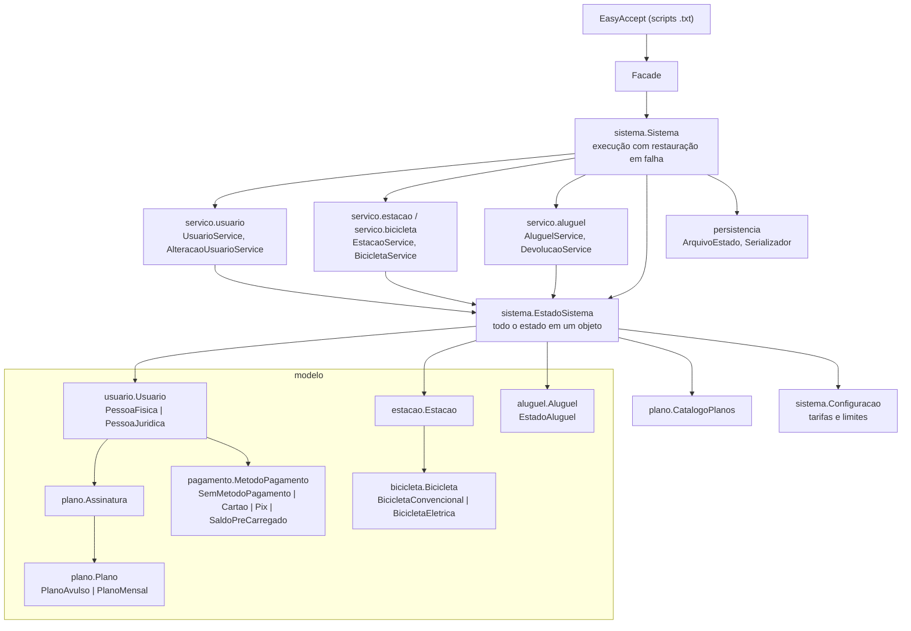

# BikeShare - Sistema de Bicicletas Compartilhadas

[](https://www.oracle.com/java/)
[](http://easyaccept.sourceforge.net/)
[](https://conventionalcommits.org)
[](https://ic.ufal.br/)

Projeto acadêmico desenvolvido para a disciplina de **Programação 2 (P2) / Programação Orientada a Objetos**, no curso de **Bacharelado em Ciência da Computação** do **Instituto de Computação (IC)** da **Universidade Federal de Alagoas (UFAL)**, semestre 2026.2.

---

## Sumário

- [1. Visão Geral do Sistema](#1-visão-geral-do-sistema)
- [2. Arquitetura e Padrões de Projeto](#2-arquitetura-e-padrões-de-projeto)
- [3. Princípios SOLID Aplicados](#3-princípios-solid-aplicados)
- [4. Regras Obrigatórias e Diretrizes de Qualidade](#4-regras-obrigatórias-e-diretrizes-de-qualidade)
- [5. Regras de Negócio](#5-regras-de-negócio)
- [6. Milestones e User Stories](#6-milestones-e-user-stories)
- [7. Persistência de Dados](#7-persistência-de-dados)
- [8. Padrão de Versionamento (Conventional Commits)](#8-padrão-de-versionamento-conventional-commits)
- [9. Como Executar os Testes](#9-como-executar-os-testes)
- [10. Glossário](#10-glossário)
- [11. Autoria](#11-autoria)

---

## 1. Visão Geral do Sistema

O **BikeShare** é a lógica de negócio de um serviço de bicicletas compartilhadas, no estilo dos sistemas usados em várias cidades brasileiras. O sistema cadastra **usuários** (pessoa física ou jurídica), **estações** com um número fixo de vagas e **bicicletas** convencionais ou elétricas. Um usuário retira uma bicicleta em uma estação, usa-a por um tempo (um **aluguel**) e a devolve em qualquer estação com vaga livre; o valor é calculado na devolução, de acordo com o **plano** do usuário.

### Objetivos Principais:
- **Separação Rígida de Camadas**: o sistema contém **apenas a lógica de negócio**, sem interface gráfica e sem banco de dados. Toda a comunicação externa passa por uma fachada pública usada pelos scripts de teste.
- **Conformidade de Requisitos**: obter **100% de aprovação** nos testes de aceitação do **EasyAccept** (`tests/us1.txt` a `tests/us16.txt`, com as continuações `_1`). O Milestone 1 (US1 a US9) está completo.
- **Modelagem Orientada a Objetos**: as diferenças entre tipos de usuário, bicicleta, plano e método de pagamento são resolvidas por polimorfismo, nunca por `instanceof`.

---

## 2. Arquitetura e Padrões de Projeto



> Os pacotes `excecao` e `util` são usados por todas as camadas e ficaram fora do diagrama para não poluí-lo.

### Pacotes

| Pacote | Conteúdo |
|---|---|
| `bikeshare` | `Facade` (ponto de entrada do EasyAccept) |
| `excecao` | `BikeShareException` (classe-mãe) e os erros agrupados em `validacao`, `usuario`, `plano`, `pagamento`, `estacao`, `bicicleta`, `aluguel` e `sistema` |
| `modelo` | o domínio dividido por assunto: `usuario`, `plano`, `pagamento`, `estacao`, `bicicleta`, `aluguel` |
| `servico` | casos de uso, chamados pela fachada |
| `sistema` | coordenador (`Sistema`), estado completo (`EstadoSistema`), coleções com geração de ids (`Cadastro`) e parâmetros (`Configuracao`) |
| `persistencia` | gravação e leitura do estado em disco |
| `util` | regras de preenchimento (`Validador`), formatação de dinheiro (`Formato`) e de datas (`Datas`) |

### Padrões de Projeto Empregados

1. **Façade**: [`Facade`](BikeShare/src/br/ufal/ic/p2/bikeshare/Facade.java) só encaminha. Os comandos que alteram o estado passam por `Sistema.executar`, e as consultas vão direto ao serviço.
2. **Strategy**: o que varia é um objeto trocável.
   - [`Plano`](BikeShare/src/br/ufal/ic/p2/bikeshare/modelo/plano/Plano.java): cada plano calcula a tarifa de uma corrida (`calcularTarifa`) e decide se cobra mensalidade.
   - [`MetodoPagamento`](BikeShare/src/br/ufal/ic/p2/bikeshare/modelo/pagamento/MetodoPagamento.java): cada método autoriza a retirada e cobra a corrida do seu jeito, e expõe só os dados que possui.
   - [`Bicicleta`](BikeShare/src/br/ufal/ic/p2/bikeshare/modelo/bicicleta/Bicicleta.java): a elétrica sobrescreve a checagem de bateria e o adicional por minuto.
3. **Null Object**: [`SemMetodoPagamento`](BikeShare/src/br/ufal/ic/p2/bikeshare/modelo/pagamento/SemMetodoPagamento.java) representa o usuário que ainda não cadastrou forma de pagamento, em vez de `null`.
4. **Factory**: o enum [`TipoBicicleta`](BikeShare/src/br/ufal/ic/p2/bikeshare/modelo/bicicleta/TipoBicicleta.java) cria a bicicleta de cada tipo, sem `switch`; [`FabricaMetodoPagamento`](BikeShare/src/br/ufal/ic/p2/bikeshare/modelo/pagamento/FabricaMetodoPagamento.java) cria o método de pagamento pedido.
5. **State (enum)**: [`EstadoAluguel`](BikeShare/src/br/ufal/ic/p2/bikeshare/modelo/aluguel/EstadoAluguel.java) decide, em cada estado, o que o aluguel aceita (só o aluguel em andamento é devolvido; só o encerrado tem fim e valor).
6. **Memento**: [`Sistema`](BikeShare/src/br/ufal/ic/p2/bikeshare/sistema/Sistema.java) copia o estado antes de cada comando e restaura essa cópia se o comando falhar no meio. A mesma cópia servirá de base para o undo/redo (US16, Milestone 2).

---

## 3. Princípios SOLID Aplicados

- **S (SRP)**: cada serviço cuida de um assunto; a leitura de atributos fica em `AtributosUsuario`, a validação de entrada em `Validador` e a gravação em `persistencia`.
- **O (OCP)**: um novo plano é um novo `Plano` no catálogo; um novo método de pagamento é uma nova subclasse de `MetodoPagamento`. Quem calcula ou cobra não muda.
- **L (LSP)**: qualquer `Usuario`, `Plano` ou `MetodoPagamento` pode ser usado onde a classe-mãe é esperada.
- **D (DIP)**: os serviços dependem das abstrações do domínio, nunca de uma subclasse escolhida por `if`.

---

## 4. Regras Obrigatórias e Diretrizes de Qualidade

> [!CAUTION]
> As regras abaixo são **obrigatórias e avaliadas** pelos monitores e pelo professor (veja também [`regras_monitores.txt`](regras_monitores.txt)).

| Regra | Como o projeto cumpre |
|---|---|
| **Proibido o uso de `instanceof`** | O código não tem `instanceof` nem `getClass()`. O que só existe em um tipo (CPF, CNPJ, número do cartão, chave pix, saldo, nível de bateria) é pedido por polimorfismo; nos outros tipos, o método lança o erro de negócio certo. |
| **Proibido lançar exceções genéricas** | Todo erro é uma subclasse de `BikeShareException`, com a mensagem exata que o EasyAccept espera. Falhas de arquivo viram `PersistenciaException`, que guarda a causa original. |
| **Princípio DRY** | As regras de preenchimento ficam em `Validador`; a formatação de dinheiro em `Formato`; a geração de ids em `Cadastro`. |
| **Herança semântica correta** | `PessoaFisica` e `PessoaJuridica` só acrescentam o próprio documento; `BicicletaEletrica` só acrescenta a bateria. O que é comum fica na classe-mãe. |
| **Foco em polimorfismo** | Planos, métodos de pagamento, tipos de usuário e de bicicleta não são decididos por `switch` sobre o tipo. |

Outras garantias:
- **Restauração em falha**: se um comando falhar no meio, o estado volta a ser exatamente o de antes, e o id que seria gerado não é consumido.
- **Objetos sempre válidos**: `Usuario`, `Estacao`, `Cartao`, `Pix` e `BicicletaEletrica` recusam dados vazios ou fora do intervalo; a estação não recebe bicicleta além da capacidade.
- **Parâmetros configuráveis**: tarifas, franquia, mensalidade padrão, carência, tempo máximo, adicional da elétrica, bateria mínima e multa por atraso ficam em [`Configuracao`](BikeShare/src/br/ufal/ic/p2/bikeshare/sistema/Configuracao.java), não espalhados pelo código.
- **Dinheiro em `BigDecimal`**: sem erro de arredondamento de `double`.

---

## 5. Regras de Negócio

| Parâmetro | Valor padrão |
|---|---|
| Tarifa do plano avulso | R$ 0,50 por minuto |
| Plano assinante | 60 minutos grátis por corrida, R$ 0,30 por minuto excedente, mensalidade padrão de R$ 30,00 |
| Adicional da bicicleta elétrica | R$ 0,20 por minuto, cobrado mesmo dentro da franquia |
| Bateria mínima para retirada | 15% |
| Carência | até 2 minutos, devolvendo na mesma estação: aluguel cancelado, sem cobrança |
| Tempo máximo | 24 horas; acima disso o aluguel expira |
| Multa por atraso | R$ 10,00 |

**Usuários**: o identificador é gerado pelo sistema (`U1`, `U2`...) e nunca é reaproveitado, nem depois de remoções. Cadastros recusados não consomem id. O email é único, sem diferenciar maiúsculas de minúsculas. Campos preenchidos só com espaços contam como vazios. Quem tem aluguel em andamento não pode ser removido.

**Planos**: o usuário pode informar o plano e a mensalidade no cadastro; sem plano, ele fica no avulso. O plano avulso não tem mensalidade, e informá-la é um erro. Escolher de novo o plano atual mantém a mensalidade contratada.

**Pagamento**: cartão e Pix autorizam qualquer corrida. O saldo pré-carregado precisa ser positivo para retirar e cobrir o valor para devolver; se não cobrir, a devolução é recusada e o aluguel continua em andamento. O saldo fica guardado na conta mesmo se o usuário trocar de método e voltar.

**Retirada**: o usuário precisa estar ativo e sem aluguel em andamento; a bicicleta precisa estar disponível, naquela estação e, se for elétrica, com bateria suficiente. Bicicletas elétricas abaixo do mínimo ocupam vaga mas não contam como disponíveis.

**Devolução**: a estação precisa ter vaga. Acima do tempo máximo o aluguel expira sem cobrança da tarifa, o usuário recebe a multa e fica inadimplente, e a bicicleta vai para manutenção. Na mesma estação, dentro da carência, o aluguel é cancelado. Nos demais casos, o valor é `tarifa do plano + adicional da bicicleta`.

---

## 6. Milestones e User Stories

### Milestone 1 (User Stories 1 a 9)
- [x] **US1**: Cadastrar usuário pessoa física (CPF) ou jurídica (CNPJ e razão social)
- [x] **US2**: Consultar os atributos de um usuário e buscá-lo pelo email
- [x] **US3**: Alterar nome, email, senha, plano e método de pagamento
- [x] **US4**: Remover usuário, impedindo quem tem aluguel em andamento
- [x] **US5**: Cadastrar estação (nome, endereço e capacidade)
- [x] **US6**: Adicionar e remover bicicletas convencionais ou elétricas
- [x] **US7**: Consultar bicicletas disponíveis e vagas livres
- [x] **US8**: Retirar bicicleta, iniciando um aluguel
- [x] **US9**: Devolver bicicleta, finalizando o aluguel e calculando o valor

### Milestone 2 (User Stories 10 a 16)
- [ ] **US10**: Histórico de aluguéis do usuário
- [ ] **US11**: Valor do aluguel conforme o plano vigente
- [ ] **US12**: Criação de novos planos de tarifa
- [ ] **US13**: Bloqueios e penalidades
- [ ] **US14**: Defeito e manutenção de bicicletas
- [ ] **US15**: Relatórios de disponibilidade e faturamento
- [ ] **US16**: Desfazer e refazer operações

---

## 7. Persistência de Dados

Conforme o enunciado, o projeto não usa banco de dados:
- O estado inteiro ([`EstadoSistema`](BikeShare/src/br/ufal/ic/p2/bikeshare/sistema/EstadoSistema.java)) é gravado em `bikeshare_data.ser` com a serialização nativa do Java (`java.io.Serializable`), uma das duas opções permitidas pelo enunciado. Vão para o arquivo os cadastros, os planos e os contadores de ids.
- A serialização foi escolhida porque deixa as classes do domínio sem setters públicos e sem construtores vazios, mantendo o encapsulamento.
- A leitura e a escrita ficam isoladas em [`ArquivoEstado`](BikeShare/src/br/ufal/ic/p2/bikeshare/persistencia/ArquivoEstado.java). Um arquivo ilegível gera `PersistenciaException` em vez de começar o sistema vazio sem avisar.
- Nada vai para o arquivo antes de `encerrarSistema`, que grava o estado para o próximo script.

---

## 8. Padrão de Versionamento (Conventional Commits)

O projeto adota a convenção de mensagens de commit do [Conventional Commits](https://www.conventionalcommits.org/pt-br/v1.0.0/):

```text
<tipo>(<escopo>): <descrição no imperativo e em minúsculas>

[corpo opcional detalhando a motivação da alteração]
```

### Diretriz de Commits Atômicos (Modulares)

Cada commit contém apenas arquivos de uma responsabilidade:

- `feat(exceptions)`: exceções de negócio da User Story.
- `feat(models)`: modelos de domínio.
- `feat(persistence)`: gravação e leitura do estado em disco.
- `feat(services)`: serviços de negócio.
- `feat(usN)`: ligação da User Story na fachada.
- `docs(...)`: documentação.

---

## 9. Como Executar os Testes

O projeto usa o **EasyAccept** ([`BikeShare/lib/easyaccept.jar`](BikeShare/lib/easyaccept.jar)). Todos os comandos abaixo rodam na pasta [`BikeShare`](BikeShare/).

### 9.1 Compilação estrita (0 erros e 0 warnings)

```bash
# Linux / macOS / Git Bash
javac -encoding UTF-8 -Xlint:all -cp lib/easyaccept.jar -d out $(find src -name "*.java")
```

```powershell
# Windows (PowerShell)
javac -encoding UTF-8 -Xlint:all -cp "lib/easyaccept.jar" -d out (Get-ChildItem -Path "src" -Filter "*.java" -Recurse | Select-Object -ExpandProperty FullName)
```

### 9.2 Todos os scripts de uma vez

A classe [`Main`](BikeShare/src/Main.java), fornecida pelo monitor, roda em ordem todos os scripts de US1 a US16, incluindo as continuações `_1`. Os scripts do Milestone 2 (US10 em diante) ainda falham, porque essas US não foram implementadas. Para conferir só o Milestone 1, use o `testar.sh` (seção 9.3):

```bash
java -cp "out:lib/easyaccept.jar" Main     # Linux / macOS
java -cp "out;lib\easyaccept.jar" Main     # Windows
```

### 9.3 Scripts específicos

O script [`testar.sh`](BikeShare/testar.sh) compila e roda os scripts pedidos:

```bash
bash testar.sh us1 us1_1 us2 us3 us3_1 us4 us4_1 us5 us5_1 us6 us6_1 us7 us8 us8_1 us9 us9_1
```

---

## 10. Glossário

| Termo | Definição |
|---|---|
| **Usuário** | Pessoa cadastrada, identificada por um id gerado pelo sistema. Pode alugar bicicletas. |
| **Estação** | Ponto físico com um número fixo de vagas (`capacidade`), onde bicicletas ficam disponíveis para retirada e podem ser devolvidas. |
| **Vaga** | Espaço livre em uma estação: `vagas livres = capacidade − bicicletas presentes`. |
| **Aluguel (corrida)** | Uso de uma bicicleta por um usuário, da retirada até a devolução. |
| **Plano** | Modalidade de cobrança: *avulso* (paga cada minuto) ou *assinante* (mensalidade com franquia de minutos grátis). |
| **Penalidade** | Cobrança extra lançada sobre um usuário (atraso, dano...). Enquanto não for quitada, o usuário fica *inadimplente*. |
| **Método de pagamento** | Cartão, Pix ou saldo pré-carregado. |

---

## 11. Autoria

Desenvolvido por **Anna Beatriz Bernardo Gomes** ([@nanameetscode](https://github.com/nanameetscode)).

Instituto de Computação (IC) — **Universidade Federal de Alagoas (UFAL)**.
